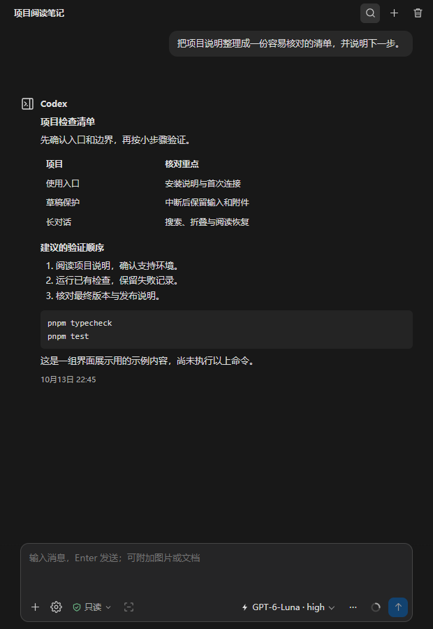
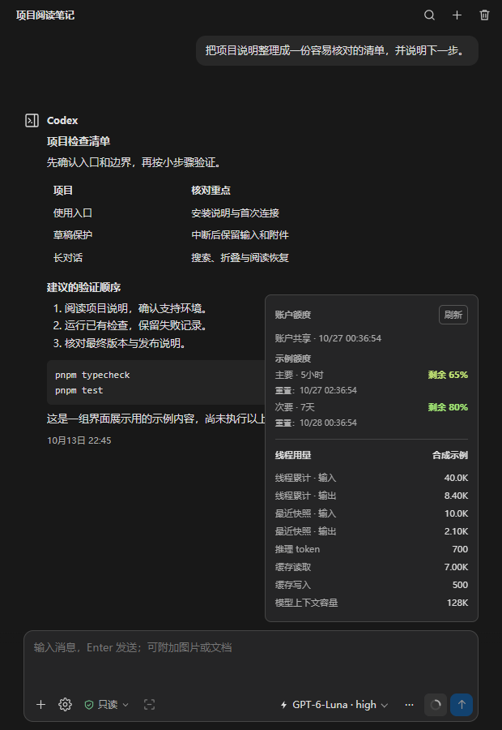
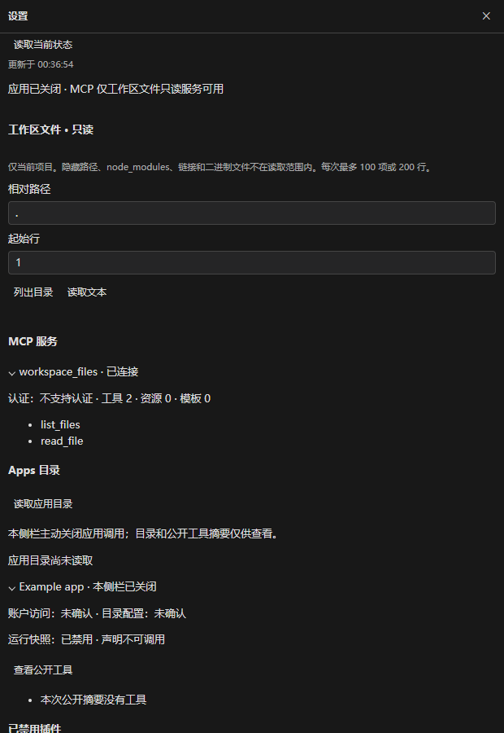

# Codex Sidebar

在 VS Code 侧栏里使用 Codex 对话，并整理长回复、图片、文档和工作区草稿。

这是从 DSH 演进而来的独立、非官方项目，不由 OpenAI 提供或背书。首期面向 **Windows x64 本地工作区**，通过 GitHub Releases 提供 VSIX，暂不上架 VS Code Marketplace。

> **有限验证预览版。** 公开后端初始化和只读文件工具已验证；新账号在线对话、真实编辑器首装及升级仍待验收。详见[验证范围](docs/RELEASE_READINESS.md)。

配图由生产界面在浏览器中渲染，使用虚构对话和额度；不是实际账号或原生 VS Code 窗口截图。

## 为长对话准备的侧栏

- **阅读与定位**：流式回复、Markdown、代码、公式和表格；正文折叠、回合导航、收藏与阅读位置恢复。
- **草稿与队列**：按会话保留草稿和附件；生成中可主动排队；中断或发送结果不明时暂停，保护原提交与新草稿。
- **图片与文档**：粘贴、拖放或选择文件；图片预览和动图选帧；本地提取 PDF、Word、Excel、PowerPoint 文本。
- **历史与搜索**：管理本插件的工作区会话，搜索消息及已发送的文档文字，定位到对应回合或附件。
- **对话控制**：选择后端提供的模型和思考强度，切换聊天／规划模式，停止生成、主动压缩，以及确认后回退对话。
- **额度随时可看**：连接就绪后后台读取，正常情况下每分钟更新；点击圆环先显示缓存，也可手动刷新。
- **统一界面**：深浅主题、收起／展开控件、键盘焦点及窄栏布局。
- **有限工具接入**：当前项目文件只读 MCP；设置页可查看 Apps 目录和状态。

## 使用前了解这些边界

| 能力 | 当前范围 |
|---|---|
| 支持环境 | Windows x64、VS Code 1.125.0 或以上、本地受信任工作区；其他环境尚未验收 |
| Codex 后端 | 独立启动受支持的本地 App Server；VSIX 不含后端二进制或账号凭据 |
| 账号与模型 | 需要有效的 Codex 登录及相应模型权限；侧栏不提供账号额度或模型授权 |
| Apps | 可查看目录／公开工具摘要；**调用主动关闭** |
| MCP | 仅当前工作区文件的列目录与读文本；不开放任意 MCP 服务 |
| ChatGPT Chat／Dot | 未集成 |
| 命令与文件操作 | 审批仍有范围限制；不能把权限选项当作全部原生工具已开放 |
| 对话回退 | 删除所选回合及之后的对话历史；**不恢复磁盘文件** |
| 文档解析 | 提取文字，不运行 OCR，不保留原版式，不将文档内图片自动交给模型 |
| 搜索 | 本插件当前工作区已确认的会话与受限缓存，不是账号全局搜索 |
| 本地听写 | 依赖 Windows 语音组件、语言包、麦克风权限及 PowerShell 7；识别质量需自行体验 |

## 安装与开始使用

先阅读[安装指南](docs/INSTALLATION.md)，从 [GitHub Releases](https://github.com/Enxulansis/codex-sidebar/releases) 下载预览版 VSIX、`SHA256SUMS.txt` 和 `setup-backend.mjs`：准备受支持后端并通过官方流程登录，再从 VSIX 安装扩展。安装脚本需要 Node.js 22.19.0 或以上；语音等系统功能另需 PowerShell 7。

已有开发版用户：本项目保留扩展 ID **`lixxx1-lab.dsh-codex-experiment`**，作为同一扩展更新。独立的是源码仓库和展示名称；不需要为了改名删除历史、清空草稿或另建扩展身份。

连接成功后，打开侧栏、新建会话，核对模型和权限，再发送第一条消息。发送附件前可先查看本地预览。遇到发送结果不明，请先核对历史，不要连续重发。

## 额度与工具一目了然

账户额度与线程用量分别展示。失败时保留缓存和更新时间，不把旧数据伪装成刚刷新成功。

可查看与可执行明确区分：文件服务仅当前项目只读，Apps 目录展示不启用应用调用。

## 文档

| 文档 | 内容 |
|---|---|
| [详细使用手册](docs/USER_GUIDE.zh-CN.md) | 对话、草稿、附件、阅读、搜索、额度与工具 |
| [安装指南](docs/INSTALLATION.md) | 环境、后端、登录、VSIX、更新与回退 |
| [常见问题](docs/TROUBLESHOOTING.md) | 连接失败、模型、附件、额度和诊断 |
| [开发说明](docs/DEVELOPMENT.md) | 独立构建、测试与打包 |
| [发布准备状态](docs/RELEASE_READINESS.md) | 已验证内容、待验证项及发布条件 |

## 来源与许可

本项目基于 Lixxx1 的 DSH 代码演进，保留其 [MIT 许可](LICENSE)和署名。第三方依赖、Material Icon Theme 文件图标和协议来源见 [THIRD_PARTY_NOTICES](THIRD_PARTY_NOTICES.md)。侧栏图形为本项目原创；Codex、ChatGPT 和 VS Code 等名称属于各自权利人。

提交问题时请描述复现步骤、系统／编辑器／插件版本，以及脱敏后的错误信息。不要提交登录文件、令牌、完整真实聊天记录或包含个人文件路径的截图。
