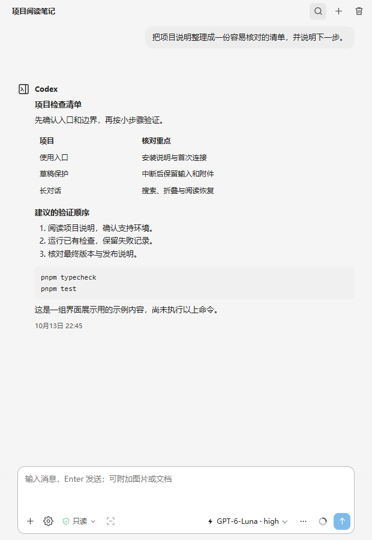
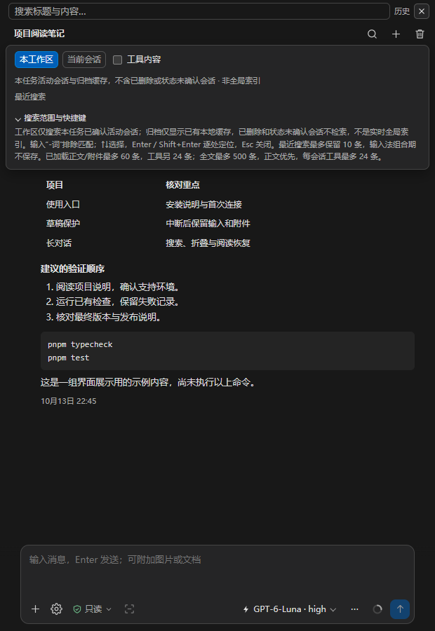
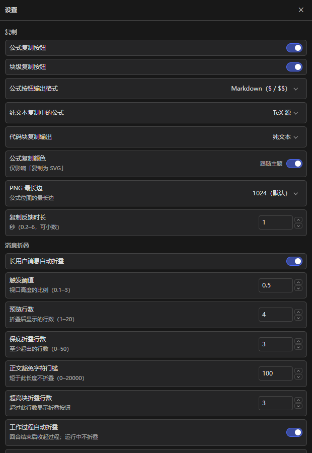

# 详细使用手册

本手册对应 dev.22 独立预览候选。配图来自当前生产界面在浏览器中的渲染，使用虚构内容，不代表真实账号调用或原生编辑器验收。

## 1. 会话与输入

打开受信任的本地项目，通过“打开 Codex 侧栏”进入。连接就绪后新建会话，核对模型、思考强度和权限。模型可用性由后端与账号决定；当前基线首次默认 `gpt-6-luna / low`，该默认值不保证每个账号都可用。

侧栏记录自己在当前工作区确认拥有的会话，不自动扫描所有官方历史。已发送的会话可以恢复；尚未发送的空会话在后端重启后可能没有持久记录，这时保留本地草稿，并提示新建会话。

“/”入口读取技能目录，主动选择后随消息发送。技能存在不代表依赖的 Apps 或 MCP 已开启。来源变化、目录失败或禁用时，应刷新核对。

## 2. 草稿、排队与停止

草稿和附件按会话保护。发送明确失败时保留草稿；发送结果未知时分别保留原提交和后来输入的新稿，核对历史后再决定恢复或关闭原内容。恢复原内容不会发送，也不会覆盖非空新稿。

生成过程中可主动把消息加入本地队列。只有当前回合明确完成后才逐条发送；停止、断线、重载或结果未知会暂停队列。队列中的内容与后来新输入的草稿相互独立。

“停止”中断当前生成或文档准备，不会自动重发。后端历史可能不包含中断时尚未落盘的部分回复；恢复后的缺失提示不能理解为完整回复已保存。

## 3. 文件、图片与文档

通过“+”、粘贴或拖放添加附件。侧栏图片与文件合计最多 20 项，动图所选一帧计一项；文件大小、文字预算及存储配额另行限制。

图片支持预览与缩放。GIF、APNG、WebP 可选择具体帧；直接发送原动图并不保证模型理解全部帧。需要比较多个时刻时，主动选帧后发送。

TXT、Markdown、CSV 和代码文件读取文字；PDF、DOCX、XLS、XLSX、PPTX 在本地提取文字后发送。没有 OCR，不提取文档图片作为模型图像输入，不执行宏或外链。扫描 PDF、加密文件、损坏文件或超预算会提示失败，不静默截断成“完整文档”。

文件卡可以查看来源、复制名称／路径及另存。预览 PDF 依赖 VS Code 的查看能力；Office 预览交给系统默认应用。成功打开入口不等于外部查看器已完成显示。

自动附带活动文件默认关闭。主动开启后只读取已保存的磁盘快照，使用一个自动附件槽，保留手动附件。移除同一文件后不会因再次保存而自动加回。

## 4. 阅读、折叠与导航

长对话正文采用阅读窗口，逻辑历史与当前渲染内容分开。使用回合导航定位，折叠长正文／代码，收藏重要回合，返回保存的阅读位置。图片或宽度变化时会重新校准布局。

展开／收起控件支持键盘焦点，正文操作区在聚焦时显示。恢复定位等待过久时可以继续或取消；手动滚动可接管阅读。

## 5. 搜索

搜索覆盖本插件在当前工作区确认拥有的活动会话，以及归档前已存在的受限缓存。不会主动补读归档全文，也不会把未读取部分当成没有结果。归档命中会标识，恢复后再核对和跳转。

已发送文档的文字可参与全文搜索，结果定位到附件卡片；当前已加载搜索也包含文件名。这不是跨工作区或账户全局索引。

## 6. 模型、规划与权限

模型旁的“⋯”可选择普通聊天或规划模式，选择按会话保存，只影响后续新回合。切换会暂停本地队列，不会自动改为更贵模型。

原生提问在草稿上方单独显示，支持选项与自定义回答。答题内容与草稿分开；提交后等待后端确认，未知结果不自动重发。敏感问题输入当前为可见文字，请注意旁观环境。

新建或重连默认只读。提高权限需要明确确认，仅作用于本线程后续回合，活动回合不切换。界面显示选择、受理与生效回执，但这些状态不保证所有原生工具均已开放：本地命令审批仍有白名单，文件变更需完整差异且目标位于当前工作区。

## 7. 压缩与对话回退

额度面板提供主动压缩入口。压缩影响后端上下文，不是清理本地附件的操作。

完成回复的“更多操作”中可选择“回退到此回合之前…”。先核对回复及将移除的回合数，再确认。所选回合的提问、回复和之后的历史会被移除，**磁盘文件不会恢复**。

回退保留当前草稿、附件及队列，队列暂停。存在未确认发送、待处理原内容或异常队列时不允许回退；回执不明时先恢复核对，不自动重试。

## 8. 账户额度

日常连接就绪后后台读取一次，正常完成后每 60 秒更新。隐藏侧栏或关闭额度面板仍更新；点击圆环立即显示当前连接的缓存，手动刷新与正在进行的请求合并。

失败保留上次成功数据及时间，连续失败会延长间隔，最多 5 分钟。切换账号清空旧额度，断连／退出停止轮询。缓存仅在当前连接内存中，不跨连接保留。额度属于账号共享信息；线程用量是另一组统计，不能相互代替。

## 9. 设置、存储与听写

设置页管理主题及附件存储等选项，检查存储和清理范围后再执行清理。不要把附件清理理解为删除账号对话，也不要把重装插件当作自动备份。

听写先列出本机语言，主动点击“开始听写”才开启麦克风。“停止并加入草稿”把预览插入当前光标处，不自动发送；取消、隐藏侧栏或切换会话会丢弃当次预览。需要 PowerShell 7、System.Speech、相应语言和麦克风权限。真实中文识别质量仍需体验。

## 10. MCP 与 Apps

设置中先“读取当前状态”，再使用工作区文件只读服务。相对路径仅指当前项目，支持列目录与读文本；隐藏路径、node_modules、链接、硬链接和二进制不在读取范围内。目录最多 100 项；文本最多 1 MiB，结果最多 200 行／24000 字符，截断时按提示继续。

读取结果只在设置中展示，不自动添加到聊天。停止等待不代表服务端读取已取消；关闭设置或切换后不显示迟到结果。

Apps 可主动读取目录，查看账户访问、配置及运行快照。目录可见或摘要标注只读，都不代表允许执行；**当前 Apps 调用关闭**。本地文件服务无需 OAuth，本版没有新增 Apps 登录或令牌保存流程。ChatGPT Chat、Dot 和桌面宿主插件未集成。
